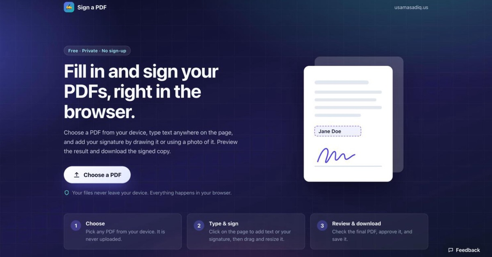

# Sign a PDF

Sign a PDF for free, right in your browser, without uploading it anywhere.

**[Open Sign a PDF](https://usamasadiq.us/sign-a-pdf/)** · [How it works & FAQ](https://usamasadiq.us/posts/sign-pdf-online-free-without-uploading/)



## What it does

1. Choose a PDF from your device.
2. Type text anywhere on a page: names, dates, form fields.
3. Draw your signature, or use a photo of it. A white background is removed automatically.
4. Move and resize anything you placed.
5. Preview the real output file, then download the signed copy.

No account, no watermark, no upload. The PDF is read and written inside the browser tab, so it never leaves your device.

## Feedback

Found a problem or have an idea? Use the **Feedback** button on the page; no GitHub account needed. Messages are posted here as [issues](https://github.com/UsamaSadiq/sign-a-pdf/issues).

## How it works

- [pdf.js](https://github.com/mozilla/pdf.js) renders each page to a canvas.
- [@cantoo/pdf-lib](https://github.com/cantoo-scribe/pdf-lib) writes text and signature images into the original PDF.
- Placed items are stored as fractions of their page and converted to PDF coordinates with pdf.js's viewport transform, so rotated and cropped pages work.
- Latin text is embedded as selectable text; other scripts, such as Urdu, are drawn as high-resolution images.
- The only server-side piece is a small Cloudflare Worker in [`worker/`](worker) that turns feedback form messages into GitHub issues. It never receives PDFs or signatures.

This places a visible electronic signature. It does not create a certificate-based digital signature.

## Development

```sh
npm install
npm run dev
```

Open the URL Vite prints (it ends in `/sign-a-pdf/`). `npm run build` writes the static site to `dist/`, which GitHub Actions deploys to GitHub Pages on every push to `main`.

The feedback endpoint is set by `VITE_FEEDBACK_URL` in `.env`; without it the Feedback button is hidden. To deploy the Worker:

```sh
cd worker
npx wrangler deploy
pbpaste | npx wrangler secret put GITHUB_TOKEN
```

The token needs only **Issues: Read and write** on this repository. Pipe it in as shown: run without a terminal prompt, `wrangler secret put` stores an empty value.

## License

[MIT](LICENSE)
